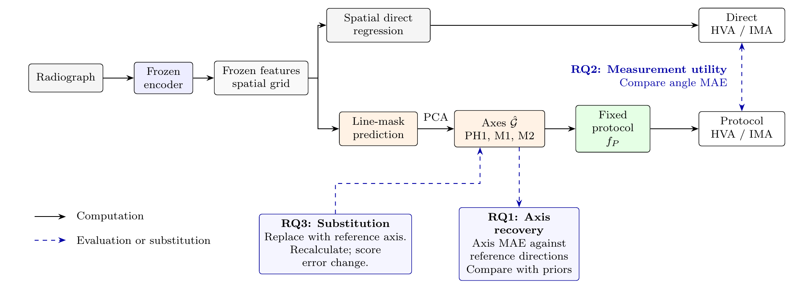
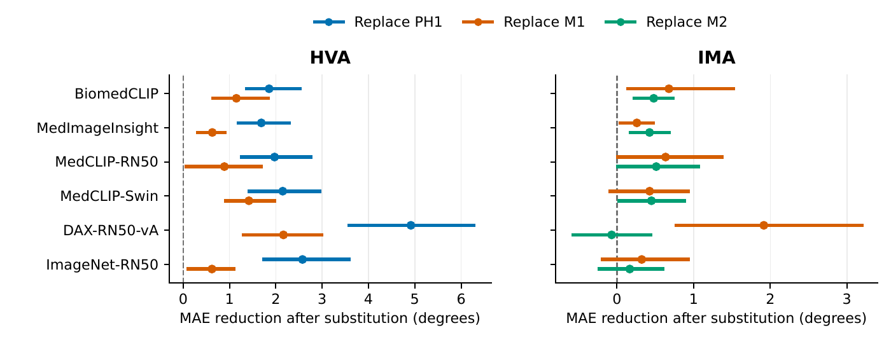

<div align="center">

# Axis2Angle

### Does Predicting Anatomical Axes Improve Foot Angle Measurement?<br>Recovery, Measurement Utility, and Reference-Axis Substitution

Hongcheng Jiang · Cheng Han\* · ZhiQiang Chen · Dianxiang Xu

University of Missouri–Kansas City, United States<br>
\*Corresponding author

[Results](#results) · [Installation](#installation) · [Data](docs/data.md) · [Training and evaluation](docs/experiments.md) · [Citation](#citation)

</div>



**Figure 1. Recovery, measurement utility, and reference-axis substitution.** The same frozen spatial features feed either a direct angle regressor or a mask decoder. PCA extracts axes from the predicted masks, and the fixed clinical protocol computes HVA and IMA. The three evaluations separately assess axis recovery, measurement accuracy, and the effect of replacing a predicted axis with its reference.

## Results

HVAngleEst, patient-disjoint test split: 176 images from 133 patients. MAE in degrees, mean ± sample SD across seeds 17, 42, and 73. **G-dir** directly regresses angles from the spatial grid; **M-mask** predicts axis masks and applies the angle protocol.

| Frozen encoder | Axis MAE | G-dir HVA | M-mask HVA | G-dir IMA | M-mask IMA |
|:--|--:|--:|--:|--:|--:|
| BiomedCLIP | 2.570 ± 0.145 | 5.269 ± 0.103 | 4.166 ± 0.136 | 2.676 ± 0.090 | 2.726 ± 0.022 |
| MedImageInsight | 2.473 ± 0.027 | 4.054 ± 0.033 | 3.746 ± 0.160 | 2.255 ± 0.007 | 2.318 ± 0.100 |
| MedCLIP-RN50 | 4.032 ± 0.202 | 5.544 ± 0.093 | 5.463 ± 0.421 | 2.571 ± 0.043 | 3.918 ± 0.108 |
| MedCLIP-Swin | 4.407 ± 0.369 | 5.458 ± 0.257 | 6.032 ± 0.408 | 2.743 ± 0.111 | 4.111 ± 0.249 |
| DAX-RN50-vA | 6.779 ± 0.409 | 7.992 ± 0.090 | 10.302 ± 0.536 | 2.934 ± 0.083 | 5.709 ± 0.925 |
| ImageNet-RN50 | 4.468 ± 0.292 | 6.052 ± 0.265 | 6.192 ± 0.079 | 2.811 ± 0.149 | 3.665 ± 0.539 |

Accurate axis recovery does not establish better angle measurement: multiplicity-adjusted intervals support no HVA improvement over G-dir and higher IMA error for four of six encoders.

<details>
<summary>Reference-axis substitution</summary>



**Reference-axis substitution (paper figure).** Replacing one predicted direction with its reference changes the angle error without retraining. Replacing PH1 lowers MedImageInsight HVA MAE by 45.0%; the shared M1 axis affects HVA and IMA differently. These substitutions are diagnostic and use reference annotations.

</details>

## Installation

Python 3.11 and PyTorch 2.4. Install encoder-specific source packages as described in [Data](docs/data.md).

```bash
pip install -r requirements.txt
```

Follow [data preparation](docs/data.md), then [training and evaluation](docs/experiments.md) for M-mask, G-dir, P-dir, D-dir, A-dir, and H-end.

## Citation

```bibtex
@misc{jiang_axis2angle,
  title={Does Predicting Anatomical Axes Improve Foot Angle Measurement? Recovery, Measurement Utility, and Reference-Axis Substitution},
  author={Jiang, Hongcheng and Han, Cheng and Chen, ZhiQiang and Xu, Dianxiang},
  howpublished={\url{https://github.com/DIGiTLabHub/Axis2Angle}}
}
```
